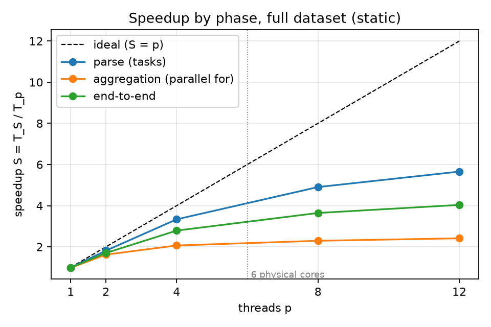
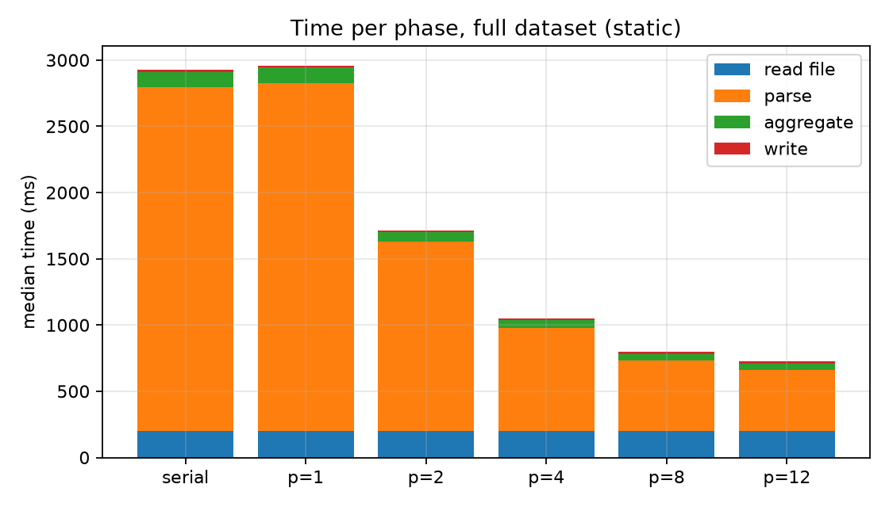
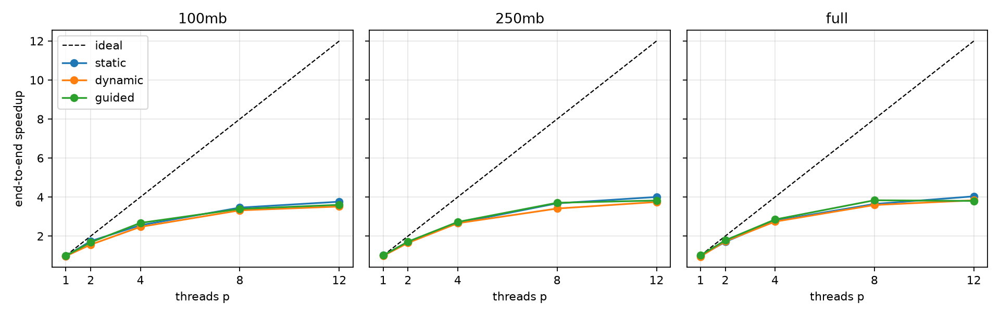
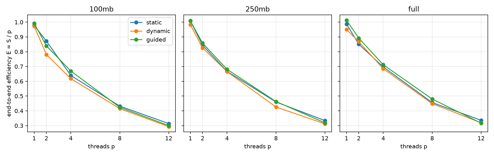
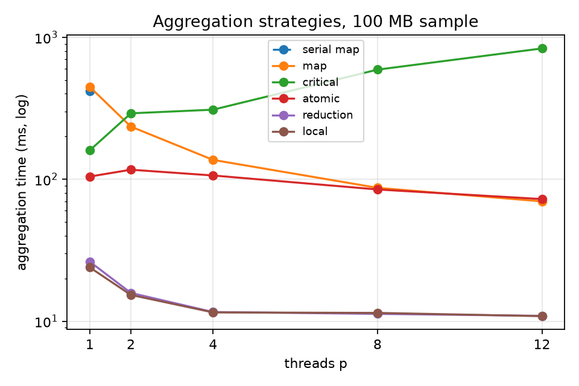
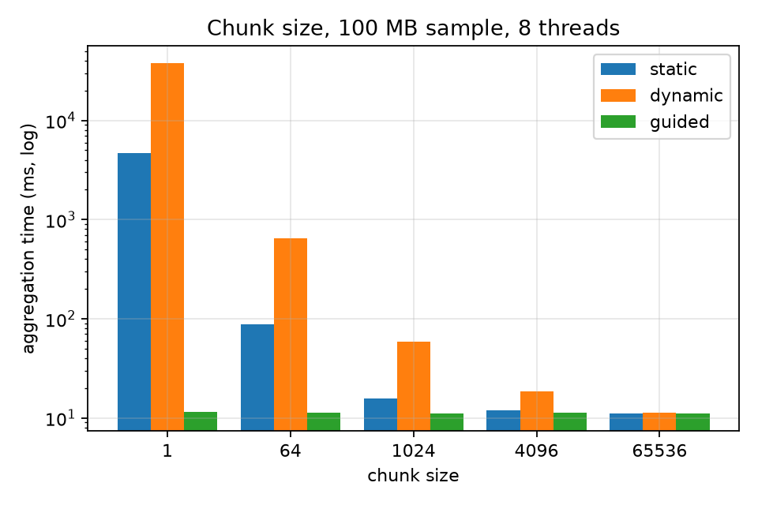
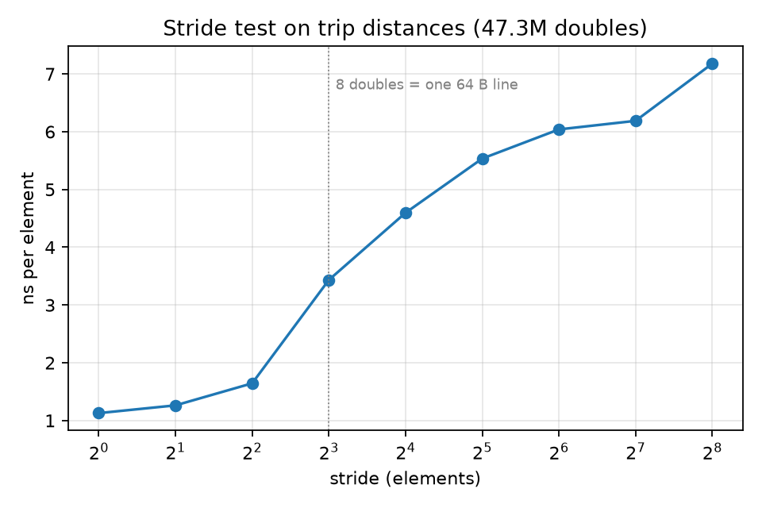
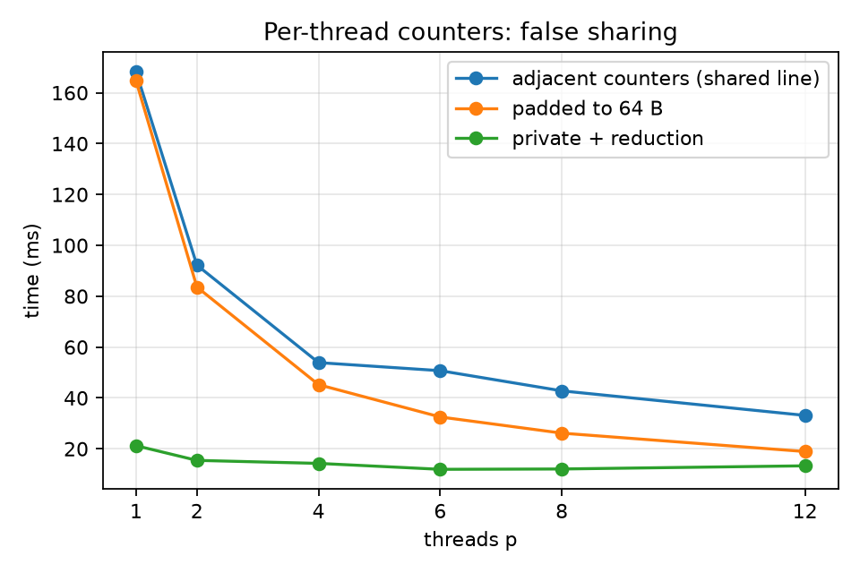

# Crazy Taxi – Phase 1 Report: Parallel Foundations

SW 401 Parallel and Distributed Systems, Fall 2025 · Amr Abdelfattah (Parallelization Lead), Momen Sanad (Performance Analyst), Khalid Mohamed (Code Integrator / Tester), Abdelrahman Abdelrassoul (Documentation Coordinator) · Repository: github.com/0x3mr/crazy-taxi

## 1. Dataset and preprocessing

We use the **NYC TLC Yellow Taxi Trip Records for January–December 2025**, published by the NYC Taxi & Limousine Commission as twelve monthly Parquet files. Together they hold **48,722,602 trips** with 20 columns each: 830 MB compressed, 1.29 GB uncompressed according to the Parquet metadata. Every trip is an independent record, so the data can be split at any record boundary. That is what makes it suitable for OpenMP now, MPI in Phase 2 and Hadoop in Phase 3.

`preprocessing/prepare_taxi.py` reads each month with PyArrow, applies the rules below in order and writes one CSV line `pickup_zone_id,hour_of_day,trip_distance` per kept trip. A dropped row is counted under the first rule it fails. The whole run takes about 45 s.

| rule | dropped |
|---|---|
| pickup timestamp missing | 0 |
| pickup date outside 2025 (stray 2008/2009/2024/2026 dates) | 29 |
| pickup zone missing or outside the TLC IDs 1..265 | 0 |
| distance missing, NaN/inf or ≤ 0 | 1,402,958 |
| distance > 100 miles (odometer errors, max raw value was far larger) | 2,870 |
| exact duplicate of another trip in the same month (10 trip fields) | 0 |
| **total dropped** | **1,405,857 (2.9 %)** |

| | records | size |
|---|---|---|
| raw, 12 Parquet files | 48,722,602 | 829,973,299 B (compressed) |
| cleaned CSV | 47,316,745 | 536,349,586 B |
| sample "100 MB" | 9,250,534 | 104,857,584 B |
| sample "250 MB" | 23,126,336 | 262,144,884 B |

Almost all dropped rows have a zero distance. These are mostly cancelled or "no trip" meter records. No exact duplicates were found: the TLC files appear to be de-duplicated already, but the check stays in the pipeline. The hour is the stored local wall-clock hour of the pickup, with no time-zone conversion. Distances are written in the shortest form that reads back to the same `double` (e.g. `1.6`). That is why the cleaned file is 536 MB, so we made 100 MB and 250 MB subsets instead of the suggested 500 MB one. The subsets take evenly spaced rows over the whole year, so they have the same seasonal mix as the full file. A 10,000-row sample is committed under `data/sample/`, and all statistics are in `results/preprocessing_stats.json`.

## 2. Problem and serial baseline

**Problem.** For each (pickup zone, pickup hour) pair, compute the number of trips, the total distance and the average distance. There are 265 × 24 = 6,360 possible groups, and 6,159 appear in 2025. This is a group-by aggregation, the same computation that becomes a MapReduce job in Phase 3.

**Baseline design** (`src/analytics.cpp`, `src/serial.cpp`). The program runs in four timed phases:

1. **read** – the whole CSV is read into one `std::string` with a single `read()` call;
2. **parse** – each line is split on commas and converted with `std::from_chars` (no locale, no allocation), then validated and stored in a `std::vector<Trip>` (`Trip` = `int zone, int hour, double distance`, 16 bytes);
3. **aggregate** – the zone range is found and the trips are added into a *dense table*, two flat arrays `counts[(zone-min)*24 + hour]` and `sums[...]` of 6,360 entries (≈ 100 KB, fits in L2). If the zone IDs were spread too widely (> 220 bins), a `std::map` is used instead;
4. **write** – the 6,159 groups are written in (zone, hour) order.

The first version in the repository parsed with `std::istringstream` and `std::stoi/stod` and aggregated into a `std::map`. On the test machine it needed a median of **45.5 s** for the full file, and 43.4 s of that was spent parsing. The current serial program needs **2,928 ms** (read 200, parse 2,593, aggregate 118, write 14 ms). On the 100 MB sample the `std::map` aggregation takes 419 ms against 24 ms for the dense table. We kept the faster program as TS, because speedups measured against a slow baseline would look better than they really are.

**Correctness.** (a) `tests/test_analytics.py` checks hand-computed groups, CRLF files, files without a final newline and malformed rows, which must fail with the right line number. It also runs 20,000 random trips through every strategy × schedule × thread count. (b) `tests/crosscheck_pyarrow.py` recomputes the group-by with PyArrow's own CSV reader and hash aggregation, which shares no code with ours. On the full data, all 6,159 counts match exactly, the counts add up to 47,316,745, and the largest relative error in a distance sum is 3.5 × 10−14. (c) Every OpenMP output is compared with the serial output by `tests/validate_results.py`: counts must be exact, sums within a relative error of 10−10.

## 3. Parallelization with OpenMP

The read and write phases stay serial. Read is a single sequential file read, and write is 6,159 lines. Parse and aggregate are parallel (`src/openmp.cpp`):

**Parsing with tasks.** The text is cut into `8·p` pieces of equal byte size, and every cut is moved forward to the next newline. A `#pragma omp parallel for` first counts the lines in each piece, and a prefix sum gives each piece its offset in the output array. One thread then creates a `#pragma omp task` per piece inside `parallel` + `single`, and each task parses its piece directly into its slice of a single `new Trip[n]` array. Pieces do not have exactly the same parsing cost, so using 8 tasks per thread balances the load. Because `Trip` is trivial, `new[]` does not zero the 757 MB array, and each task is the first to touch its pages. Our first version had each task fill its own `std::vector`, then concatenated them into a zero-initialised vector. That doubled the memory traffic and page faults, and it only reached 2.1× at 4 threads. If a task hits a bad line it stores the `exception_ptr`. The input is then re-parsed serially so the error message reports the true line number.

**Aggregation – five strategies** (`--strategy`), all under `#pragma omp parallel for schedule(runtime)` so the schedule is chosen with `omp_set_schedule`:

| strategy | how the shared table is updated |
|:---|:---|
| `local` (default) | each thread fills a private `DenseTable`, then merges it once inside `#pragma omp critical` (p merges of 6,360 bins) |
| `reduction` | `reduction(+ : cnt[:bins], sum[:bins])`, an OpenMP 4.5 array-section reduction (private copies created by the runtime) |
| `atomic` | one shared table, `#pragma omp atomic` on the count and on the sum |
| `critical` | one shared table, both updates inside `#pragma omp critical` |
| `map` | per-thread `std::map`, merged under `critical` (the original design) |

The zone range is found first with `reduction(min : lo) reduction(max : hi)`. There are no data races. Each thread writes only its own table, and the shared table is touched either inside `critical` or `atomic`, or by the runtime's reduction step. The integer counts are identical for every strategy. The floating-point sums differ only in the last digits, because the additions happen in a different order.

## 4. Performance results

**Setup.** Intel Core i7-8850H laptop CPU (6 cores / 12 hardware threads, 2.6 GHz base, 9 MB L3), 32 GB RAM, Windows 11. GCC 13.2 (MSYS2 UCRT64) with `-O3 -fopenmp` (libgomp, OpenMP 4.5). Every configuration was run **5 times**, and the tables use the **median**. TS is always the median time of the serial program on the same input. The input file stays in the OS page cache, so "read" is a memory copy, not disk I/O. Raw data: `results/timings.csv` (439 runs). All tables: `results/summary.md`.

**Full dataset (47.3 M trips), static schedule, median ms:**

| p | read | parse | aggregate | write | end-to-end | S | E = S/p | f (Karp–Flatt) |
|---|---|---|---|---|---|---|---|---|
| serial | 200 | 2,593 | 118.4 | 14 | 2,928 | 1.00 | – | – |
| 1 | 199 | 2,623 | 120.9 | 14 | 2,967 | 0.99 | 0.99 | – |
| 2 | 200 | 1,429 | 73.0 | 15 | 1,720 | 1.70 | 0.85 | 0.175 |
| 4 | 203 | 777 | 57.3 | 14 | 1,050 | 2.79 | 0.70 | 0.145 |
| 8 | 203 | 529 | 51.6 | 14 | 803 | 3.65 | 0.46 | 0.171 |
| 12 | 203 | 459 | 49.1 | 14 | 725 | 4.04 | 0.34 | 0.179 |

Per phase at p = 8: **parse 4.90×**, aggregation 2.29×, end-to-end 3.65×. The same pattern holds on the smaller inputs. At p = 8 the end-to-end speedup is 3.46× on 100 MB, 3.68× on 250 MB and 3.65× on the full file, and at p = 12 it rises from 3.76× (100 MB) to 4.04× (full).

Figure 1 – Left: speedup of each phase, full dataset. Right: where the time goes (read and write stay constant at ≈ 217 ms).

Figure 2 – End-to-end speedup and efficiency for the three schedules on the three input sizes.

**Schedules.** Every trip costs the same to aggregate, so the work per iteration is even and **static is the right choice**. It has no run-time bookkeeping and gives each thread one contiguous block, which is the best case for the hardware prefetcher. Guided starts with large blocks and comes out practically equal (50.4 vs 51.6 ms at p = 8, within run-to-run noise). Dynamic with chunk 4096 is clearly worse in aggregation (90.9 ms at p = 8) because every 4096 iterations each thread goes back to a shared counter. The chunk-size experiment (100 MB, 8 threads) shows how much this overhead matters:

| chunk | 1 | 64 | 1,024 | 4,096 | 65,536 |
|---|---|---|---|---|---|
| static | 4,656 | 87.5 | 15.7 | 11.9 | 11.2 |
| dynamic | 37,623 | 648.5 | 59.1 | 18.6 | 11.3 |
| guided | 11.6 | 11.4 | 11.2 | 11.3 | 11.0 |

With `dynamic,1`, the loop that takes 11 ms needs **37.6 s**, about 4 µs per iteration, because every single iteration is requested from the runtime's shared work queue. The cache line holding the queue's counter moves between the cores all the time. Static with chunk 1 is also slow (4.7 s): blocks are handed out per iteration through `schedule(runtime)`, and neighbouring trips in the same cache line belong to different threads, so every thread pulls in every line. Guided does not care about the chunk size, because the chunk is only its *minimum* size. This also explains the bad "dynamic" numbers of the first version of the project, which used chunk 1.

**Aggregation strategies** (100 MB sample, static, median ms):

| strategy | p = 1 | 2 | 4 | 8 | 12 |
|---|---|---|---|---|---|
| serial `std::map` | 419 | | | | |
| `map` (per-thread maps) | 447 | 235 | 137 | 87 | 70 |
| `critical` | 160 | 291 | 309 | 592 | 835 |
| `atomic` | 105 | 117 | 106 | 85 | 73 |
| `reduction` (array section) | 26.3 | 15.8 | 11.6 | 11.3 | 10.9 |
| `local` (private table + 1 critical merge) | 23.9 | 15.3 | 11.5 | 11.4 | 10.8 |

Figure 3 – Left: aggregation strategies (log scale). Right: chunk size per schedule (log scale).

A `critical` section on every update gets *slower* with more threads: at 12 threads it is 77× slower than `local`. The threads spend their time handing the lock to each other. `atomic` avoids the lock, but every update is still a locked read-modify-write on a shared cache line. For the `double` sum this is a compare-and-swap loop, so even with one thread it is 4× slower than a plain add. `reduction` and `local` do the same thing (private copies, combined once at the end) and give the same times. This is exactly the advice from Labs 4 and 5: use reductions or private data, not fine-grained `critical`. The per-thread `std::map` scales well (6.4× at p = 12), but each step is a tree search, so it stays 6.5× slower than the dense table. Picking the right data structure gave more than the threads did.

## 5. Amdahl, Gustafson and profiling

**Amdahl.** The truly serial work is reading the file and writing the result: 200 + 14 = 214 ms, or **7.3 %** of TS. Amdahl's law with f = 0.073 predicts S(8) = 1 / (0.073 + 0.927/8) = 5.3 and an upper limit of 1/f ≈ 13.7. We measure 3.65 at p = 8, and the Karp–Flatt estimate of the serial fraction is **f ≈ 0.15–0.18**, roughly twice the code that is really serial. The difference is overhead that grows with p rather than serial code: (i) aggregation is limited by memory bandwidth (below); (ii) beyond 6 threads the two hyper-threads of a core share one core's execution units, so parse goes only from 4.9× to 5.7× between p = 8 and 12; (iii) the line-counting pass, creating 8p tasks and the first touch of the 757 MB trip array (page faults) all cost time that grows with the data or with p. The fact that f stays nearly constant from p = 2 to 12 fits a fixed serial part plus a bandwidth ceiling.

**Gustafson.** In the parallel run at p = 8, the serial share is s = 217 / 803 = 27 %. Gustafson's scaled speedup p − (p − 1)s = **6.1** says that if the data grew with the number of threads and the run time stayed at 0.8 s, 8 threads would process about 6× more trips than one thread. We see the start of this in the measurements: at p = 12 the speedup grows from 3.76× (100 MB) to 4.00× (250 MB) to 4.04× (full) as the input gets bigger. The larger the parallel part of the work, the less the fixed read/write cost matters. Phase 2 (MPI over several nodes) is where this will matter, because each rank then reads its own part of the file in parallel.

**Profiling (gprof).** Built with `-DTAXI_GPROF=ON` (on MinGW it needs `-no-pie` and a fixed load address, otherwise gprof records no samples); output is in `results/profiling/`. Not counting the instrumentation itself (`_mcount`, `__fentry__`), **≈ 94 % of the serial samples are in parsing** (`parse_line`, the line loop, `from_chars`) and ≈ 6 % in `aggregate_serial`. This is why parsing was the part worth parallelising, and why the overall speedup follows the parse curve. Hardware counters (`perf stat`) were not available: the test machine runs Windows without a Linux kernel. So the cache analysis below uses timing experiments, and the `perf` command for Linux is in the README.

**Memory hierarchy.** *Stride test* (`cache_test`, Figure 4): the 47.3 M distances (378 MB, far larger than the 9 MB L3) are summed with stride s, so every element is still read exactly once per pass. Up to stride 4 the time rises only slowly (1.13 → 1.64 ns per element), because several elements share each 64-byte line. From stride 8 onward every access touches a new line, so each 8-byte value costs a whole line from DRAM, and the time jumps to 3.4 ns and then 7.2 ns at stride 256, where the prefetcher also stops helping. *Data layout:* with four partial sums, summing the distances from the 16-byte `Trip` array (AoS) takes 268 ms for 5 passes, against 95 ms from a packed `double` array (SoA, ≈ 20 GB/s). That is 2.8× faster for half the bytes. Our aggregation reads the whole 16-byte `Trip`, so its best case is about 757 MB at that rate, ≈ 38 ms. We measure 49 ms at p = 12, which is why aggregation stops scaling at about 2.4×: **it is memory-bound, not compute-bound**. A more compact record (e.g. `uint16 zone, uint8 hour, float distance` = 8 bytes) would make it about 2× faster.

Figure 4 – Left: stride test. Right: per-thread counters stored adjacently, padded to 64 bytes, or private + reduction.

**False sharing and synchronisation** (`false_sharing`, full data). Each thread counts its trips longer than 2 miles (22.5 M trips) in its own slot of a shared array, written on every hit:

| p | 1 | 2 | 4 | 6 | 8 | 12 |
|---|---|---|---|---|---|---|
| adjacent counters (ms) | 168 | 92 | 54 | 51 | 43 | 33 |
| padded to 64 B (ms) | 165 | 84 | 45 | 33 | 26 | 19 |
| private + `reduction(+)` (ms) | 21 | 15 | 14 | 12 | 12 | 13 |

With one thread, adjacent and padded counters cost the same, because no line is shared. From 4 threads on, the adjacent version is 1.2–1.75× slower: the 8 counters sit in one 64-byte line, which bounces between cores even though no two threads touch the same counter. Padding removes this, but the private-counter version is still 1.5–8× faster than padding. It keeps the counter in a register and writes shared memory once. Our real code follows this rule: the `local` strategy builds each thread's `DenseTable` inside the parallel region (its own heap memory) and merges it once. The first version kept the per-thread maps next to each other in one `std::vector<Results>`, so their headers shared cache lines. A header only changes when a new group is inserted (6,159 times in total), so the effect there was negligible. With per-thread *counters* in one array, it would not have been.

## 6. Reflection – remaining bottlenecks

1. **Reading and writing are serial** (≈ 217 ms, 27 % of the run at p = 8). Reading could overlap with parsing (parse the first block while the next is read). In Phase 2, each MPI rank will read its own byte range, which removes this cost from the critical path.
2. **Memory bandwidth limits aggregation.** A smaller record (8 bytes instead of 16), or aggregating directly while parsing (no trip array at all), would cut the traffic. Fusing parse and aggregate in each task would also remove the 757 MB array and its page faults.
3. **Parsing stops scaling at the core count.** With 6 physical cores, hyper-threads add only ≈ 15 %. Remaining per-line costs could be cut with a hand-written integer parser and by skipping validation of rows that preprocessing has already validated.
4. **Text is a costly format.** 89 % of the serial time is spent turning text into numbers. A binary file of `Trip` records would make loading almost free. We keep CSV because Hadoop Streaming in Phase 3 needs text lines and because it keeps the comparison fair across phases.
5. **Measurements are from one laptop.** Turbo boost and background tasks make single runs vary by a few percent, which is why we report the median of 5 runs. Results on a Linux machine with `perf` counters will be added in Phase 2.

**Reproducing.** `README.md` lists every command: download → `prepare_taxi.py` → `generate_samples.py` → CMake build → `ctest` → `benchmark.py --runs 5` → `summarize.py` → `plot_results.py` → `build_report.py`.
